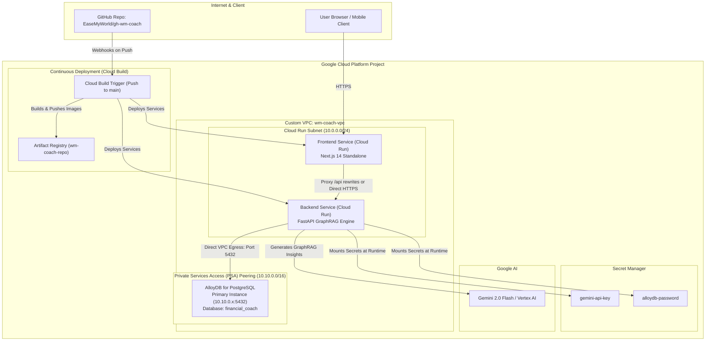

# Deployment & Cloud Architecture Guide

This guide details the deployment of **GH Wealth Management Coach (`gh-wm-coach`)** to **Google Cloud Run** with separate frontend and backend microservices, **Google Cloud AlloyDB for PostgreSQL**, **Google Gemini AI**, **VPC Direct Egress**, and **Cloud Build CI/CD** integrated with GitHub [`https://github.com/EaseMyWorld/gh-wm-coach`](https://github.com/EaseMyWorld/gh-wm-coach).

---

## 🏛️ Architecture Overview



---

## 🔑 Key Components

| Component | GCP Service | Description |
| :--- | :--- | :--- |
| **Frontend** | Cloud Run (v2) | Next.js 14 UI containerized with multi-stage standalone build. Handles interaction, live portfolio, and graph views. Proxies API requests to backend. |
| **Backend** | Cloud Run (v2) | FastAPI microservice running GraphRAG AI reasoning engine. Dual-Store integration with AlloyDB and NetworkX. |
| **Database** | AlloyDB for PostgreSQL | Fully managed, high-performance PostgreSQL-compatible database. Holds tables (`users`, `holdings`, `accounts`, `goals`) and persists knowledge graphs. |
| **AI Engine** | Google Gemini API / Vertex AI | Powers conversational wealth advisory grounded in the dual-store knowledge graph and relational numbers (`gemini-2.0-flash`). |
| **Networking** | Custom VPC + Direct VPC Egress | Cloud Run services connect directly to the custom VPC subnet without needing costly legacy Serverless VPC Access connectors. |
| **Database Peering** | Private Services Access (PSA) | VPC peering between `wm-coach-vpc` and Google Service Networking for secure private IP database access. |
| **Secrets** | Secret Manager | Securely stores `gemini-api-key` and `alloydb-password`. Injected into Cloud Run containers as environment variables at startup. |
| **CI/CD** | Cloud Build | Automates container builds and deployments triggered on pushes to `https://github.com/EaseMyWorld/gh-wm-coach`. |

---

## 🔐 Placeholders to Configure

The codebase and infrastructure scripts contain the following placeholders:

| Placeholder Variable | Where Configured | Description | How to Obtain / Set |
| :--- | :--- | :--- | :--- |
| `YOUR_GEMINI_API_KEY_HERE` | Secret Manager (`gemini-api-key`), `backend/.env` | API Key for Google Gemini | [Google AI Studio](https://aistudio.google.com/) |
| `YOUR_ALLOYDB_PASSWORD_HERE` | Secret Manager (`alloydb-password`), `terraform.tfvars` | Master password for AlloyDB `postgres` user | Choose any strong 16+ char password |
| `YOUR_GCP_PROJECT_ID` | `setup-gcp-infra.sh`, `terraform.tfvars` | Google Cloud Project ID | GCP Console |

> [!IMPORTANT]
> If `GEMINI_API_KEY` is not provided or remains as placeholder, the backend **gracefully falls back** to the built-in deterministic financial advisory logic, ensuring continuous availability.

---

## 🚀 Deployment Options

### Option 1: Automated Script (`scripts/setup-gcp-infra.sh`)

This is the fastest method to provision all Google Cloud resources and configure VPC peering.

1. **Authenticate and set your project**:
   ```bash
   gcloud auth login
   gcloud config set project YOUR_GCP_PROJECT_ID
   ```

2. **Run the infrastructure setup script**:
   ```bash
   export PROJECT_ID="YOUR_GCP_PROJECT_ID"
   export REGION="us-central1"
   export GEMINI_API_KEY="AIzaSy..."             # Your Gemini API Key
   export ALLOYDB_PASSWORD="StrongPassword123!"  # Your DB Password

   ./scripts/setup-gcp-infra.sh
   ```

3. **Deploy the application**:
   ```bash
   ./scripts/deploy.sh
   ```

---

### Option 2: Infrastructure as Code with Terraform (`terraform/`)

For production environments managed through declarative infrastructure:

1. **Navigate to the terraform directory**:
   ```bash
   cd terraform
   ```

2. **Create your `terraform.tfvars` file**:
   ```bash
   cp terraform.tfvars.example terraform.tfvars
   ```

3. **Edit `terraform.tfvars`**:
   ```hcl
   project_id     = "YOUR_GCP_PROJECT_ID"
   region         = "us-central1"
   gemini_api_key = "YOUR_GEMINI_API_KEY"
   db_password    = "StrongPassword123!"
   ```

4. **Initialize and apply**:
   ```bash
   terraform init
   terraform plan
   terraform apply
   ```

---

### Option 3: Continuous Deployment with GitHub & Cloud Build

The repository includes pre-configured Cloud Build pipelines:
- `cloudbuild.yaml`: End-to-end build and deploy for both services.
- `cloudbuild-backend.yaml`: Dedicated pipeline for backend changes.
- `cloudbuild-frontend.yaml`: Dedicated pipeline for frontend changes.

#### Connecting GitHub:
1. Open the **Cloud Build Triggers Console**:
   [https://console.cloud.google.com/cloud-build/triggers](https://console.cloud.google.com/cloud-build/triggers)
2. Click **Connect Repository** and select **GitHub**.
3. Authorize Google Cloud Build to access your GitHub account.
4. Select the repository: `EaseMyWorld/gh-wm-coach`.
5. Create a trigger:
   - **Name**: `deploy-gh-wm-coach-on-push`
   - **Event**: Push to a branch
   - **Branch**: `^main$`
   - **Configuration**: Cloud Build configuration file (`cloudbuild.yaml`)
   - **Substitution Variables**:
     - `_REGION`: `us-central1`
     - `_ALLOYDB_IP`: Private IP of your AlloyDB instance (e.g. `10.10.0.3`)

Any push or merged Pull Request to `main` on `https://github.com/EaseMyWorld/gh-wm-coach` will now automatically build and deploy both services!

---

## 🌐 VPC & Network Communication Details

### Why Direct VPC Egress?
Traditionally, Serverless VPC Access connectors required running dedicated micro-VMs (`e2-micro`) that added \$15–\$30/month in idle costs and suffered from cold-start latency. 

This architecture uses **Cloud Run Direct VPC Egress** (`--network=wm-coach-vpc --subnet=wm-coach-subnet --vpc-egress=private-ranges-only`):
- **Zero connector instances to manage or pay for**.
- **Lower latency** (sub-millisecond VPC routing).
- **High throughput** (scales automatically with Cloud Run).
- **Direct access** to AlloyDB's private IP (`10.10.0.x:5432`) across the Private Services Access peering.

### Frontend to Backend Routing
The Next.js frontend uses **Server Rewrites** configured in `next.config.mjs`:
```javascript
async rewrites() {
  return [
    {
      source: "/api/:path*",
      destination: `${process.env.BACKEND_URL}/api/:path*`,
    },
  ];
}
```
This architecture gives three distinct benefits:
1. **Zero CORS Issues**: The browser only ever talks to the frontend domain (`/api/...`).
2. **Security**: The backend can optionally be kept internal or secured with IAM credentials.
3. **Seamless Multi-Environment Support**: Local development routes to `http://127.0.0.1:8000`, while Cloud Run automatically routes to `https://wm-coach-backend-...a.run.app`.

---

## 🗄️ Database Schema & Knowledge Graph Persistence

When the backend boots on Cloud Run, `init_relational_db()` verifies or creates the following PostgreSQL tables in AlloyDB:

1. `users`: Profile, monthly income, monthly expenses, currency, and risk profile.
2. `accounts`: Bank accounts (HDFC, ICICI), demat accounts (Zerodha), balances, and sync status.
3. `holdings`: Equity stocks, mutual funds, sovereign gold bonds, and fixed deposits.
4. `transactions`: Inflow and outflow ledgers.
5. `life_goals`: Financial milestones (e.g. child education, retirement, house down payment).
6. `extracted_facts`: Audit trail of entity extractions from chats, voice recordings, and statements.
7. `knowledge_graphs`: Stores serialized semantic network (`NetworkX` node-link graph) per user, ensuring **knowledge graphs persist across Cloud Run container cold starts and scale-to-zero cycles**.

---

## 🧪 Local Testing

You can run the entire stack locally without Google Cloud resources:
- Database automatically falls back to local SQLite (`financial_ledger.db`).
- Gemini AI falls back to rule-based financial reasoning if `GEMINI_API_KEY` is not set.

```bash
# Terminal 1: Backend
cd backend
python -m venv venv && source venv/bin/activate
pip install -r requirements.txt
uvicorn app.main:app --host 127.0.0.1 --port 8000 --reload

# Terminal 2: Frontend
cd frontend
npm install
npm run dev
```

Visit [http://localhost:3000](http://localhost:3000) for the UI and [http://localhost:8000/docs](http://localhost:8000/docs) for the interactive Swagger API documentation.
